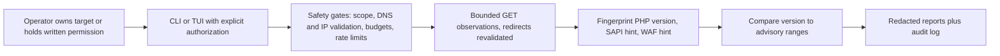
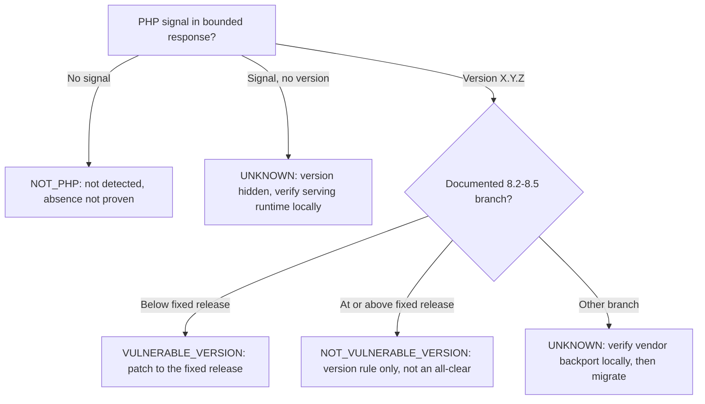

# php2shell-audit

`php2shell-audit` is a personal portfolio project for evidence-backed,
authorized PHP2Shell exposure triage. It is intended for website owners,
maintainers, and security practitioners working within explicit written scope.

It collects bounded HTTP observations, compares disclosed PHP versions with
documented advisory rules, and supports remediation review. It does not exploit
vulnerabilities, execute code on targets, upload files, or prove exploitability.

**Public reachability is not permission to scan.** Use only systems you own or
have explicit written authorization to assess. Read [Authorized Use](AUTHORIZED_USE.md)
before scanning; `--authorized` confirms permission you already hold.

## What Makes This Different

Most scanners output a bare label — vulnerable or not — and leave you to trust
it. This one **shows its work**: every verdict ships with the exact HTTP
observation behind it, the advisory range it was compared against, the sources
for that rule, how to fix it, and how to verify the fix. And when the evidence
cannot support a conclusion — hidden version, unlisted branch, vendor backport,
configuration-dependent issue — it says **unknown** and tells you what to check
locally instead of guessing. That traceability, plus authorization gates,
redaction by default, and a loopback lab anyone can rerun, is the whole point.

Start with [How to use](#how-to-use-end-to-end), review the
[example report](docs/example-report.md), inspect the
[local QA evidence](docs/qa-evidence.md), or run the
[loopback lab end to end](#checking-with-the-lab) — no target needed.

## Status

Implemented and locally verified against the bundled mock suite and the
loopback Docker lab. The security contract is enforced by the CLI, TUI, scanner,
and report writers; local QA evidence is recorded in
[docs/qa-evidence.md](docs/qa-evidence.md). Automated guardrails (pre-commit,
secret scan, dependency audit, static analysis, container scan, CI) all pass.
Licensed under the MIT License (see [LICENSE](LICENSE)). No independent
security audit has been performed; a [maintainer self-review](docs/security-review.md)
is recorded instead and is explicitly not an independent audit.

The portfolio focus is the reasoning behind a triage decision: bounded evidence
collection, explicit uncertainty, source provenance, and actionable remediation.
Evidence-to-action reports connect each version assessment to its supporting
observation and advisory rule, as described [below](#reports-and-audit-log).

## Purpose

One job: tell an authorized operator whether a web target discloses a PHP
version affected by the PHP2Shell advisories — and show the evidence trail, so
the conclusion can be checked instead of trusted.

In scope:

- Fingerprint disclosed PHP versions, SAPI hints, and WAF/intermediary hints
  from bounded `GET`/`HEAD` responses.
- Map an observed version to the documented affected ranges and fixed releases
  of CVE-2026-109618 and CVE-2026-109619, and flag the configuration-dependent
  CVE-2026-115560 as unverifiable remotely.
- Produce redacted, explainable reports (JSON, JSONL, Markdown, CSV) with
  remediation and owner-side verification steps.

Out of scope:

- Exploitation, proof-of-concept requests, webshells, or remote code execution.
- Uploads, write methods, credential attacks, session hijacking, or evasion.
- Mass scanning, target discovery, or assessing anything without permission.
- Proving exploitability or proving a target is safe.

> **No target to scan? No problem.** This repo ships a proper local lab: two
> loopback-only PHP fixtures (8.4.26 affected, 8.4.27 fixed) plus an automated
> script that starts the lab, scans both, and checks every verdict. One command,
> no external website involved:
>
> ```bash
> ./lab/scripts/verify.sh
> ```
>
> See [Checking with the Lab](#checking-with-the-lab) for the full walkthrough.

## How It Works



Each stage does exactly one thing:

| Stage | What happens | Where |
|---|---|---|
| Authorization | CLI requires `--authorized`; the TUI scan button stays disabled until its checkbox is confirmed. A scope file can narrow targets, never grant permission. | `src/php2shell_audit/cli.py`, `src/php2shell_audit/tui.py` |
| Target safety | Every target (and every redirect hop) is normalized and validated: HTTP(S) only, no userinfo, no private/link-local/metadata destinations unless `--allow-private` is explicitly passed for the local lab. | `src/php2shell_audit/safety.py` |
| Recon | Budgeted, rate-limited `GET` requests with a bounded body prefix; cookies are never sent or retained. Optional `--deep` adds status-only checks. | `src/php2shell_audit/recon.py` |
| Fingerprint | PHP version from headers, cookie names, or generator tags; conservative SAPI and WAF hints. Cookie values and response bodies are never kept. | `src/php2shell_audit/fingerprint.py` |
| Assessment | The observed version is compared to per-CVE affected ranges from the bundled snapshot. Only documented PHP 8.2–8.5 branches support decisive verdicts; everything else stays unknown. | `src/php2shell_audit/advisory.py`, `src/php2shell_audit/scanner.py` |
| Reporting | Each assessment carries its evidence, range comparison, citations, remediation, and verification steps into redacted JSON/JSONL/Markdown (CSV stays a summary). | `src/php2shell_audit/reporting.py`, `src/php2shell_audit/models.py` |

## How a Verdict Is Decided



What to do for each outcome:

| Verdict | Meaning | Next step |
|---|---|---|
| `VULNERABLE_VERSION` | The disclosed version falls inside a documented affected range. Exposure evidence, not exploit proof. | Upgrade to the branch fixed release, restart all serving workers, rescan. |
| `NOT_VULNERABLE_VERSION` | The disclosed version is at or above the fixed release for that rule. | Still verify the installed runtime and vendor backports; this says nothing about the configuration-dependent issue. |
| `POTENTIALLY_VULNERABLE_VERSION_UNKNOWN` | Version hidden, branch unsupported, or configuration-dependent condition. | Check the serving runtime locally (`php -v`), confirm distribution patches with the vendor, and review `session.upload_progress.enabled` handling. |
| `NOT_PHP` | No PHP indicator in the bounded response. | Do not read this as proof PHP is absent; proxies and settings hide banners. |
| `UNREACHABLE`, `BLOCKED_BY_SAFETY`, `WAF_BLOCKED` | Collection outcomes, not assessments. | Fix network/scope issues, confirm authorization, or accept that an intermediary blocks assessment. |

The configuration-dependent CVE-2026-115560 always stays unknown remotely:
a version banner cannot confirm the required `session.serialize_handler` and
`session.upload_progress.enabled` behavior. Its report section tells the owner
exactly what to inspect locally.

## Why the Results Are Trustworthy

**Advisory sources, not guesses.** The bundled snapshot
(`src/php2shell_audit/data/php2shell.json`) is a dated, project-maintained
synthesis — and every claim in it was checked against primary sources:

| Source | What it establishes |
|---|---|
| [PHP security announcement, 2026-10-21](https://www.php.net/archive/2026.php#2026-10-21-5) | Fixed releases 8.2.35, 8.3.36, 8.4.27, 8.5.12; unsupported branches; minimal source backports for 7.4/8.0/8.1 |
| [GHSA-w8hw-w9fx-j79w](https://github.com/php/php-src/security/advisories/GHSA-w8hw-w9fx-j79w) | CVE-2026-109618 mechanism, severity 9.2, mitigations |
| [GHSA-6wmf-4rv5-p3rp](https://github.com/php/php-src/security/advisories/GHSA-6wmf-4rv5-p3rp) | CVE-2026-109619 mechanism, severity 9.2, mitigations |
| [PHP informational notice, 2026-10-23](https://www.php.net/archive/2026.php#2026-10-23-1) | CVE-2026-115560 configuration condition and interim mitigation |
| CISA alert, CERT-EU advisory, NCSC-NL guidance | Supporting operational context (see [research notes](docs/php2shell-research.md)) |

The full provenance (snapshot date and SHA-256) ships inside every report, and
the [research notes](docs/php2shell-research.md) document exactly what is — and
is not — established for each branch.

**Tested behavior, not just code.** 653 tests cover authorization gates, target
safety, fingerprinting, redaction, version verdicts (affected, fixed, hidden,
unsupported, non-PHP, blocked), report formats, and offline end-to-end scans
through mocked HTTP. Ruff, strict mypy, and the distribution build are clean.

**Guardrails that fail closed.** Pre-commit hygiene, Gitleaks secret scanning,
pip-audit dependency audit, Semgrep static analysis, Trivy container scans, and
a CI pipeline enforcing all of them on every push and pull request. Details in
[`.claude/README.md`](.claude/README.md) and [`CLAUDE.md`](CLAUDE.md).

**Validated against a real lab.** The loopback-only PHP 8.4.26/8.4.27 pair is
scanned by an automated script that checks exact target URLs, exact versions,
and per-CVE verdicts — see [checking with the lab](#checking-with-the-lab)
and [docs/qa-evidence.md](docs/qa-evidence.md).

## How to Use, End to End

Prerequisites: Python 3.12 and `uv`. Docker with Compose is only needed for
the local lab.

### 1. Install

```bash
uv sync
```

### 2. Sanity-check the tool and its advisory data

```bash
uv run php2shell-audit version
uv run php2shell-audit advisories
```

### 3. Preview without touching the network

```bash
uv run php2shell-audit scan https://your-site.example --authorized --dry-run
```

Expected: a validated scan plan is printed; no DNS lookup or HTTP request is
made. Use this whenever you are unsure about scope or flags.

### 4. Scan a system you own or are authorized to assess

```bash
uv run php2shell-audit scan https://your-site.example --authorized --output-dir reports
```

Useful variations, all within the same explicit authorization:

```bash
# Several targets at once (all must be authorized; capped at 50 after dedup)
uv run php2shell-audit scan https://your-site.example https://staging.your-site.example --authorized

# Restrict to a pre-approved list (one host or URL per line)
uv run php2shell-audit scan https://your-site.example --authorized --scope scope.txt

# Bounded deep checks (status-only) plus machine-readable output
uv run php2shell-audit scan https://your-site.example --authorized --deep --format json

# CI policy: exit 1 on vulnerable (or unknown) findings
uv run php2shell-audit scan https://your-site.example --authorized --fail-on vulnerable
```

Prefer the TUI? Run `uv run php2shell-audit tui`, confirm authorization with its
checkbox, and scan from the interface. Launching it alone authorizes nothing.

### 5. Read the Markdown report

Open the newest `reports/<UTC-stamp>.md`: the summary table, then the per-target
dossier — observed evidence with its HTTP request context, the affected-range
comparison, citations, recommended action, and verification steps. Treat the
JSON report the same way if you automate on it.

### 6. Fix, verify locally, rescan

1. Upgrade to the fixed release for the branch (or a supported newer release).
2. Restart every serving PHP worker (PHP-FPM/Apache); the CLI banner can differ
   from the serving SAPI, so confirm with `php -v` on the host or container
   and check vendor backports rather than trusting a banner.
3. For CVE-2026-115560, set `session.upload_progress.enabled=0` before request
   parsing and restart workers.
4. Rescan the authorized endpoint and compare the before/after reports.

### 7. Try it safely with zero risk

```bash
uv run python examples/generate_report.py
```

This exercises the real scanner and writers against fixed in-memory fixtures
(affected, fixed, hidden-version) with no DNS, HTTP, Docker, or audit log.
Artifacts land in ignored `reports/demo/`; the committed
[example report](docs/example-report.md) shows the produced output and is
labeled synthetic.

## Scan Options

The command accepts one or more dynamic targets: `scan TARGET...`.
Only use multiple targets when all are explicitly authorized. Each target is
normalized, deduplicated, scope-checked, and independently DNS/IP-validated;
every redirect destination is revalidated before it is followed. Preview any
dynamic target list first with `--dry-run`, which prints the validated plan
without DNS, HTTP, logs, or reports.

| Option | Meaning |
|---|---|
| `--authorized` | Required confirmation of permission; omission exits 2. |
| `--scope FILE` | Restrict targets with one host or URL per line; ignore blanks and `#` comments. |
| `--output-dir DIR` | Report directory; default `reports`. |
| `--format FORMAT` | `all` (default), `json`, `jsonl`, `markdown`/`md`, or `csv`. |
| `--rate-limit N` | Request rate; default 1 request/second; `0` disables pacing. |
| `--timeout N` | Positive request timeout; default 10 seconds. |
| `--max-requests N` | Per-target request budget; default 20 (1–100). |
| `--max-targets N` | Target cap; default 10, maximum 50, after normalization/deduplication. |
| `--deep` | Optional status-only checks for `/.user.ini` and `phpinfo.php`; off by default. |
| `--allow-private` | Permit RFC1918/loopback for the local lab; metadata remains blocked. |
| `--dry-run` | Validate and print the plan without DNS, HTTP, logs, or reports. |
| `--fail-on MODE` | CI policy: `vulnerable`, `unknown`, or `never` (default); `unknown` also covers WAF-blocked and unreachable outcomes. |
| `--verbose` | DEBUG audit logging and console detail without disabling redaction. |

The CLI defaults to 10 targets and caps at 50 after normalization/deduplication.
An optional scope file restricts authorization, never grants it. The TUI applies
the same 10-target cap and keeps scanning disabled until its authorization
checkbox is checked.

## Reports and Audit Log

Each assessment is traceable: **observation and its source -> affected-version
rule -> conclusion -> recommended action**. Full reports include the observed
version, supporting HTTP request context, per-CVE range comparison, references,
remediation, and owner-side verification steps. Scan times and the advisory
snapshot date/SHA-256 identify when observations were collected and which data
supported the assessment. The hash is data identity, not a signature or proof
that a remote banner is authentic.

An affected-version report can substantiate a disclosed version's match to a
documented range. It does not establish target-specific exploitability or rule
out vendor backports. Unknown conditions explain what remains to be verified;
the tool does not manufacture evidence to force a decisive result.

### What a report looks like

Every full report follows the same structure:

1. Header: scan start/finish times plus advisory provenance (snapshot date and
   SHA-256 identifying the exact advisory data used).
2. Summary table: one row per target with verdict, PHP, SAPI, and WAF.
3. Per target: outcome sentence, PHP evidence table, assessments table, then
   one dossier per CVE — assessment details, bound HTTP evidence, recommended
   action, verification steps, and references.
4. Findings, consolidated evidence, general remediation, and limitations.

Trimmed excerpt from the synthetic [example report](docs/example-report.md)
(synthetic `.test` fixture, not a real target):

```markdown
## Target: https://affected.example.test/

Verdict: VULNERABLE_VERSION. Observed version matches an affected rule; not proof of exploitability.

### PHP Evidence

| Source | Value | Method | Final URL | Status |
| --- | --- | --- | --- | --- |
| header:x-powered-by | PHP/8.4.26 | GET | https://affected.example.test/ | 200 |

#### CVE-2026-109618: PHP memory corruption during out-of-memory handling

| Assessment detail | Value |
| --- | --- |
| Conclusion | VULNERABLE_VERSION |
| Observed version | 8.4.26 |
| Affected range | >=8.4.0 <8.4.27 |
| Affected range match | yes |
| Branch fixed version | 8.4.27 |

##### Bound HTTP Evidence

| Source | Value | Method | Final URL | Status |
| --- | --- | --- | --- | --- |
| header:x-powered-by | PHP/8.4.26 | GET | https://affected.example.test/ | 200 |

##### Recommended Action

- Upgrade to the fixed release for the branch or a supported newer release; verify distribution backports with the vendor and restart workers.

##### Verification

- Confirm the PHP version of the web-serving runtime locally, not only the CLI or remote banner.
- Check vendor security notices and installed package revisions for backported fixes.

##### Authoritative References (Attached Snapshot)

- https://www.php.net/archive/2026.php#2026-10-21-5
- https://github.com/php/php-src/security/advisories/GHSA-w8hw-w9fx-j79w
```

The full example also shows the second version-mapped CVE and the
configuration-dependent CVE staying unknown with its local verification steps.

Reports are written under `--output-dir`, normally `reports/`, with UTC-timestamped
filenames such as `20261024T121516Z.json`. If that stem is already present, the
writer uses `20261024T121516Z-1`, `-2`, and so on; all selected formats for one
scan share the same stem. The default is all four formats, so `--format` is
optional.

| Format | Intended use |
|---|---|
| JSON | Structured scan report with target results, evidence, and assessments. |
| JSONL | Line-oriented JSON for downstream processing. |
| Markdown | Summary, per-target details, evidence, remediation, and limitations. |
| CSV | Tabular results for review and comparison. |

JSON and JSONL retain report schema version 1 with additive evidence and
provenance fields; consumers should ignore unknown fields. Existing verdict
identifiers remain unchanged. CSV is intentionally a compact summary; use
Markdown or JSON/JSONL for the complete evidence chain.

The advisory snapshot is bundled at `src/php2shell_audit/data/php2shell.json`
with its `generated_at` date and SHA-256 shown in every full report. It does not
update itself. Before relying on a finding, compare that date against the cited
upstream PHP announcements and GHSA advisories; to refresh the data, update the
JSON, adjust `tests/test_advisory_data.py` for the changed rules, and rerun the
full test, lint, and type-check suite.

The structured audit log is separate:
`logs/php2shell-audit-<UTC timestamp with microseconds>.jsonl`. If that exact
default filename exists, the logger appends `-1`, `-2`, and so on; an explicit
`filename=` keeps append semantics.
Reports and logs are redacted by the tool, but review them before sharing and
keep them out of source control. Neither format nor redaction provides a
tamper-proof evidence store.

## Checking with the Lab

The lab is a private, loopback-only detector fixture: PHP 8.4.26 (affected) and
PHP 8.4.27 (fixed) behind `http://127.0.0.1:18080` and `http://127.0.0.1:18081`,
plus a static no-PHP control on `http://127.0.0.1:18082` that must report
`NOT_PHP`. It validates version detection and the no-PHP control path, not
exploitation. Bindings stay on `127.0.0.1`;
never publish or forward the vulnerable lab publicly. A source checkout is
required: lab assets are not included in the wheel.

All fixtures run non-root with dropped capabilities, read-only root filesystems,
healthchecks, and memory/CPU/process limits. They are still private test targets,
not production services.

```bash
./lab/scripts/up.sh
./lab/scripts/down.sh
```

Deployment needs only Bash and Docker with Compose: `up.sh` uses
`--wait --wait-timeout 60` and prints actual URLs; `down.sh` uses
`down -v --remove-orphans`. To customize ports, run
`cp lab/.env.example lab/.env` and edit the port values; never source that file.

For automated verification, also install `uv` and Python 3.12:

```bash
uv sync
./lab/scripts/verify.sh
```

Verification starts the lab, scans all three actual URLs with
`--authorized --allow-private --deep --format json`, and checks the expected
target URL, exact PHP version, and per-CVE verdicts in fresh per-run directories beneath
`reports/qa/lab-vulnerable/`, `reports/qa/lab-fixed/`, and `reports/qa/lab-static/`. For both
CVE-2026-109618 and CVE-2026-109619, expect `VULNERABLE_VERSION` on PHP 8.4.26
and `NOT_VULNERABLE_VERSION` on PHP 8.4.27, and expect `NOT_PHP` with no PHP
version and no CVE assessments on the static control. CVE-2026-115560 remains
configuration-dependent/unknown. Verification automatically tears down the lab;
use `KEEP_LAB=1 ./lab/scripts/verify.sh` to retain it for investigation, then
run `down.sh` explicitly.

The CLI also provides `uv run php2shell-audit lab up`, `lab status`, and
`lab down`; `lab up` labels URLs as defaults, while `up.sh` prints actual
overrides. See the [full lab guide](lab/README.md) for healthchecks, safety
controls, troubleshooting, and private remote-host access through SSH loopback
forwarding. The reference `dimasma0305/php2shell` inspired deployment patterns
only; no PoC, WordPress, or other exploit fixtures were copied.

## Safety and Limitations

- Detection-only: no exploit payloads, uploads, write methods, or credential tests.
- An affected-version match is not exploit proof; observed banners can be incomplete,
  forged, or stale. Confirm the installed runtime and vendor patch status locally.
- Hidden PHP or version information is not proof that PHP or exposure is absent.
  Hidden versions produce unknown-version verdicts when PHP is detected.
- A fixed-version result is not an all-clear: it addresses only the applicable
  version rule, not every vulnerability, runtime condition, or deployment risk.
- The bundled, dated advisory snapshot is a project-maintained synthesis of upstream
  advisories, not an authoritative upstream snapshot or a live vulnerability feed.
  Review its cited sources and date before relying on a finding.
- Do not extrapolate confirmed affected or fixed status to older or newer PHP
  branches outside the documented rules. Verify unsupported branches separately.
- WAF presence is informational, not proof of protection.
- Reverse proxies, shared hosting, and distro backports complicate interpretation.
- Remote evidence cannot confirm the runtime condition for CVE-2026-115560.

Patch the two version-mapped issues to the fixed branch release and restart all
serving workers. Separately apply `session.upload_progress.enabled=0` for the
third issue before request parsing and restart workers. Temporary mitigations
are partial; verify the actual runtime and vendor patch status locally.

## Testing

Developer verification commands:

```bash
uv run pytest
uv run ruff check .
uv run ruff format --check .
uv run mypy src
uv build
```

Security gates (all fail-closed; see [`.claude/README.md`](.claude/README.md)):

```bash
uvx pre-commit@4.7.0 run --all-files
scripts/checks/secret-scan.sh
scripts/checks/dependency-audit.sh
scripts/checks/static-analysis.sh
scripts/checks/container-scan.sh
scripts/checks/run-all.sh
```

Dependency resolution uses a 7-day cooldown (`exclude-newer` in `pyproject.toml`):
fresh resolves ignore packages published within the last 7 days, while the
committed `uv.lock` and `--frozen` installs keep builds reproducible.

Local QA evidence, including the lab scans and report excerpts, is recorded in
[docs/qa-evidence.md](docs/qa-evidence.md). The lab command resolves
`lab/compose.yaml` from a source checkout; an installed wheel may not include
the lab assets, so use `docker compose -f lab/compose.yaml` from the checkout.

## Project Layout

| Path | Purpose |
|---|---|
| `src/php2shell_audit/` | CLI/TUI, safety, recon, assessment, reporting, and domain modules. |
| `src/php2shell_audit/models.py` | Shared targets, evidence, findings, assessments, verdicts, and configuration. |
| `src/php2shell_audit/data/php2shell.json` | Dated, project-maintained synthesis of upstream advisories and references. |
| `src/php2shell_audit/report_markdown.py` | Markdown rendering of attached assessment data. |
| `src/php2shell_audit/_advisory_models.py` | Typed per-CVE metadata parsed at the snapshot seam. |
| `tests/` | Unit, integration, and interface checks; 653 tests, offline fixtures. |
| `examples/generate_report.py` | Reproducible synthetic portfolio demo (mocked HTTP, no network). |
| `scripts/checks/` | Local security gates (secret scan, audit, analysis, container scan). |
| `.github/workflows/ci.yml` | CI enforcing tests, lint, types, build, and all four scans. |
| `lab/` | Loopback-only Compose services and detector fixtures. |
| `docs/` | Research notes, design record, example report, and captured QA evidence. |
| `reports/` | Generated evidence; intended to be gitignored. |
| `logs/` | Generated structured audit logs; intended to be gitignored. |

## Further Reading

- [Example evidence-to-action report](docs/example-report.md).
- [Evidence-backed reporting design](docs/evidence-report-design.md).
- [Maintainer security self-review](docs/security-review.md).
- [Research snapshot and fixed-version matrix](docs/php2shell-research.md).
- [Authorized use and evidence handling](AUTHORIZED_USE.md).
- [Security policy, controls, and private reporting](SECURITY.md).
- [Local lab guide](lab/README.md).
